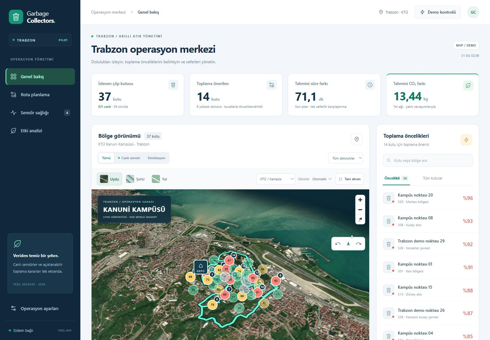

# Garbage Collectors — Akıllı Atık Yönetimi ve Operasyon Karar Destek Sistemi

**Yeşil Gelecek Hackathonu** kapsamında geliştirilen; **Arduino Uno**, **çift HC-SR04 ultrasonik sensör**, **NRF24L01 RF haberleşme** ve **ESP32 yer istasyonu** donanım zincirini, **3D harita tabanlı belediye operasyon paneli ve mobil şoför PWA'sı** ile birleştiren uçtan uca akıllı atık yönetim prototipidir.



---

## Sistem Mimarisi ve Veri Akışı

Sistem, çöp kutusundaki fiziksel ölçümden şoförün ekranındaki rota kararına kadar üç katmanda çalışır:

```text
[ Çöp Kutusu Düğümü (Node - H1) ]
  ├── Arduino Uno + 2x HC-SR04 Ultrasonik Sensör (ardışık okuma, 450 ms yankı sönümleme)
  └── NRF24L01 (2.4 GHz RF, Kanal 76, 1 Mbps, 32 bayt v3 paket, CRC16 + ACK)
            │
            ▼
[ Yer İstasyonu (Gateway) ]
  ├── ESP32 WROOM-32 + NRF24L01+PA+LNA Alıcı + 16x2 I2C LCD Durum Ekranı
  └── Wi-Fi HTTP POST (/api/telemetry — yalnızca en güncel geçerli grup iletilir)
            │
            ▼
[ Operasyon Merkezi & Mobil Sürücü Uygulaması (Python + SQLite + MapLibre GL JS) ]
  ├── Canlı ve simülasyon verisi ayrımı (1 canlı fiziksel yuva H1 + 36 simülasyon kutusu)
  ├── Açıklanabilir önceliklendirme, Theil–Sen dolum hızı tahmini ve 14 günlük talep ısı haritası
  ├── OSRM yol matrisi + en yakın komşu ve yönlü 2-opt rota planlama
  └── Mobil PWA şoför kokpiti, manevra takibi ve senaryo bazlı yakıt/CO₂ etki analizi
```

---

## Öne Çıkan Özellikler

### 1. Güvenilir Fiziksel Ölçüm ve RF Telemetri (`firmware/`)
- **Yankı Korumalı Çift Sensör Okuması:** İki HC-SR04 sensörü aynı anda tetiklenmez; her okumadan sonra **450 ms sessizlik** bırakılır. Her grupta **5 çift (10 okuma)** alınır ve ortalamanın geçerli sayılması için her iki sensörün de geçerli olduğu **en az 3 çift** aranır.
- **Sahte Veri Önleme:** Tek sensör arızası veya okuma hatası sıfır mesafeye ya da sahte `%0` doluluğa çevrilmez. Kalibrasyon yoksa yalnızca ham milimetre ortalaması raporlanır; büyük doluluk sıçramaları 3 ardışık grupla doğrulanır.
- **Kesintisiz İstasyon Görevleri:** ESP32 üzerinde 16x2 LCD güncellemesi ve Wi-Fi HTTP gönderimi ayrı görevlerde çalışır; ağ gecikmeleri RF paket alımını durdurmaz. Bağlantı koptuğunda eski paketler biriktirilip sonradan güncel veri gibi gönderilmez.

### 2. 3D Harita ve Belediye Operasyon Paneli (`app/`)
- **3D Şehir, Uydu ve Yol Görünümü:** Yerel paketlenmiş **MapLibre GL JS** üzerinde KTÜ Kanuni Kampüsü (328 bina) ve Trabzon/Ortahisar çevresi (toplam 8.244 OSM bina tabanı), Esri uydu katmanı ve 2D/3D kamera kontrolleri.
- **Açıklanabilir Karar Destek:** Her kutu için mevcut doluluk, veri güncelliği, sensör sağlığı, saatlik dolum hızı (Theil–Sen medyan eğimi) ve toplama önerisinin açık gerekçesi sunulur.
- **0–24 Saatlik Zaman Merceği ve Isı Haritası:** Gelecek saatlerdeki tahmini doluluk riskini inceleme ([PWA.md](app/PWA.md)) ve son 14 günlük güvenilir geçmişten hesaplanan kapasite/dolum hızı ısı haritası ([HEATMAP.md](app/HEATMAP.md)).
- **Rota Planlama ve Etki Hesabı:** Araç kapasitesi ve sefer süresi sınırları içinde OSRM yol ağı üzerinden rota oluşturulur. Operatör kutuları elle rotaya dahil edebilir veya hariç tutabilir. Sabit referans senaryosu ve sıralama etkisi için mesafe, süre, yakıt ve $\text{CO}_2$ karşılaştırması şeffaf varsayımlarla gösterilir.

### 3. Mobil PWA ve Şoför Kokpiti
- **Tek Dokunuşla Sürüş Modu:** Mobil görünümde ortadaki kamyon butonuyla seçili kaynak için yol rotası oluşturulur ve tam ekran şoför kokpiti açılır.
- **Canlı GPS ve Demo Sürüşü:** Gerçek cihaz GPS'i (HTTPS/localhost üzerinde) veya 150 saniyelik simülasyon sürüşü ile sıradaki durak, kalan mesafe ve OSRM dönüş manevraları takip edilir.

---

## Hızlı Başlangıç

### 1. Web Uygulaması ve Operasyon Paneli

Python 3.10+ yeterlidir; sunucu için harici Python veya npm paketi gerekmez:

```powershell
python -m app.server
```

Tarayıcıdan **http://127.0.0.1:8080** adresini açın. Uygulama varsayılan olarak 36 simülasyon kutusu ve veri bekleyen 1 canlı sensör yuvası (`H1`) ile başlar.

Yol servisine (OSRM) istek yapmadan tamamen yerel/çevrimdışı rota hesabı ile başlatmak için:

```powershell
python -m app.server --offline
```

### 2. Donanım (Arduino Uno & ESP32) Kurulumu ve Canlı Bağlantı

Donanım kurulumu, Wi-Fi/API yapılandırması, iki karta yazılım yükleme ve fiziksel kutu kalibrasyonu için adım adım kılavuz:

1. Wi-Fi ve backend adresini yapılandırın:
   ```powershell
   python firmware/tools/configure_gateway.py --ssid "WIFI_ADINIZ" --backend-url "http://<BILGISAYAR_IP>:8080/api/telemetry"
   ```
2. Arduino Uno (`uno_node_1`) ve ESP32 (`esp32_gateway`) kartlarına firmware v3 yükleyin:
   ```powershell
   ./firmware/tools/build.ps1 -Environment uno_node_1 -Upload -Port COM5
   ./firmware/tools/build.ps1 -Environment esp32_gateway -Upload -Port COM6
   ```
3. Backend'i yerel ağdaki ESP32'nin erişebileceği şekilde başlatın ve fiziksel kalibrasyonu tamamlayın:
   ```powershell
   python firmware/tools/start_backend.py
   python firmware/tools/calibrate_bin.py --node 1
   python firmware/tools/check_link.py --samples 3 --timeout 45 --require-fill
   ```

Ayrıntılı donanım yönergeleri için [firmware/UPLOAD_AND_VERIFY.md](firmware/UPLOAD_AND_VERIFY.md) ve [firmware/README.md](firmware/README.md) belgelerine bakın.

---

## Test ve Doğrulama

Proje; Python birim/entegrasyon testleri, JavaScript harita/rota/PWA sözleşme testleri ve C++ firmware simülasyon testlerini içerir. Repo kök dizininden çalıştırmak için:

```powershell
# Backend, tahmin, rota ve telemetri sözleşme testleri
python -m unittest discover -s app/tests -v

# Harita sahnesi, rota matematiği, talep modeli ve PWA testleri
node app/tests/test_map_scene.cjs
node app/tests/test_route_math.cjs
node app/tests/test_demand.cjs
node app/tests/test_future_pwa.cjs

# Firmware C++ yerel testleri ve Python alıcı testleri
python firmware/tools/run_tests.py
```

---

## Proje Yapısı ve Belgeler

```text
├── app/                                # Python HTTP sunucusu, SQLite depolama, rota/tahmin motoru ve Web/PWA arayüzü
│   ├── web/                            # MapLibre 3D sahne, şoför kokpiti, PWA servis çalışanı ve yerel veri/kütüphaneler
│   ├── reports/                        # Harita doğrulama raporu, mock veri analizi ve arayüz ekran görüntüleri
│   ├── tests/                          # Python ve Node.js birim/sözleşme testleri
│   ├── README.md                       # Operasyon paneli, karar kuralları, API ve demo akışı kılavuzu
│   ├── PWA.md                          # Mobil kurulum, HTTPS, şoför modu ve çevrimdışı çalışma detayları
│   └── HEATMAP.md                      # 14 günlük geçmişe dayalı talep ısı haritası yöntemi
├── firmware/                           # Arduino Uno (düğüm) ve ESP32 (yer istasyonu) PlatformIO C++ projesi
│   ├── src/ & include/                 # v3 ölçüm, CRC16/ACK RF protokolü, LCD ve HTTP gönderim kodları
│   ├── tools/                          # Derleme, yükleme, kalibrasyon ve canlı bağlantı doğrulama araçları
│   ├── tests/                          # C++ donanım taklit (fake) testleri ve Python entegrasyon testleri
│   ├── README.md                       # Firmware v3 mimarisi, pin bağlantıları ve protokol özeti
│   └── UPLOAD_AND_VERIFY.md            # İki karta yükleme, ağ ayarı ve canlı kalibrasyon rehberi
└── donanim_ve_haberlesme_spesifikasyonu.md # İlk aşama donanım güç topolojisi ve pin eşleştirme spesifikasyonu
```

> **Not:** Kök dizindeki [donanim_ve_haberlesme_spesifikasyonu.md](donanim_ve_haberlesme_spesifikasyonu.md) belgesi projenin ilk fazındaki güç katmanı, TP4056/Step-Up/E-Stop bağlantıları ve pin topolojisini açıklar. Güncel **v3 RF protokolü** (Kanal 76, 1 Mbps, 5 çift okuma, 450 ms sessizlik, CRC16/ACK) için [firmware/README.md](firmware/README.md) esas alınmalıdır.

---

## Ekip

- **Atagün Körükmez** — Yazılım mimarisi, belediye operasyon arayüzü, rota/tahmin modelleri ve ürün geliştirme
- **Barış Demir** — Gömülü sistemler, sensör ve güç elektroniği, RF/Wi-Fi haberleşme ve donanım entegrasyonu
